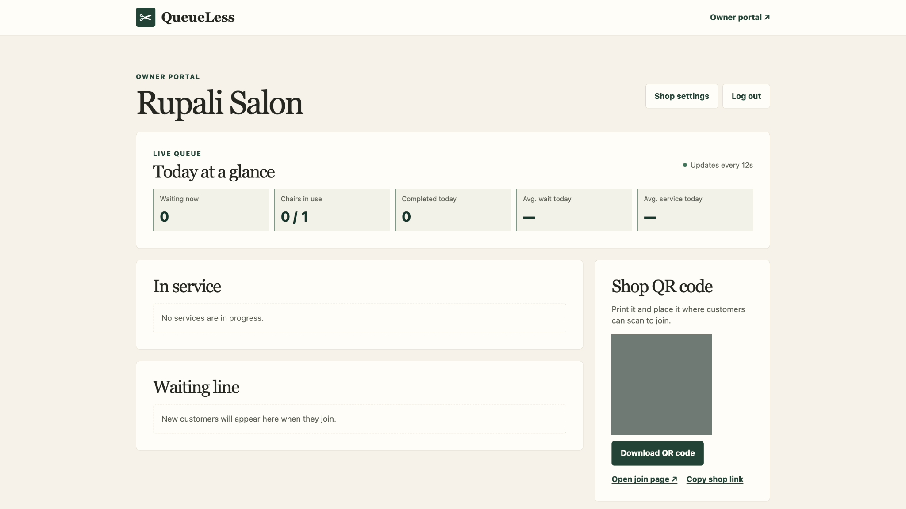
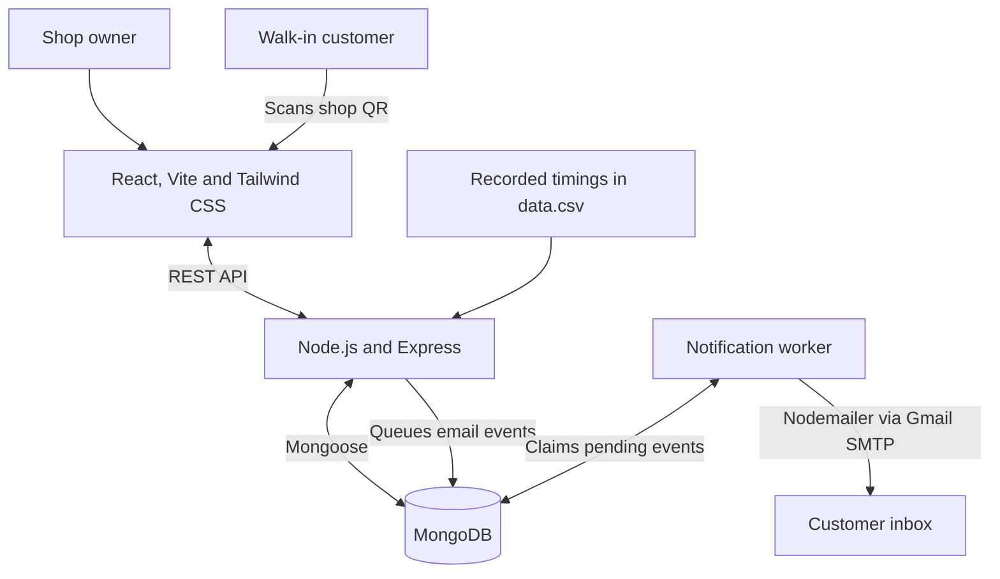
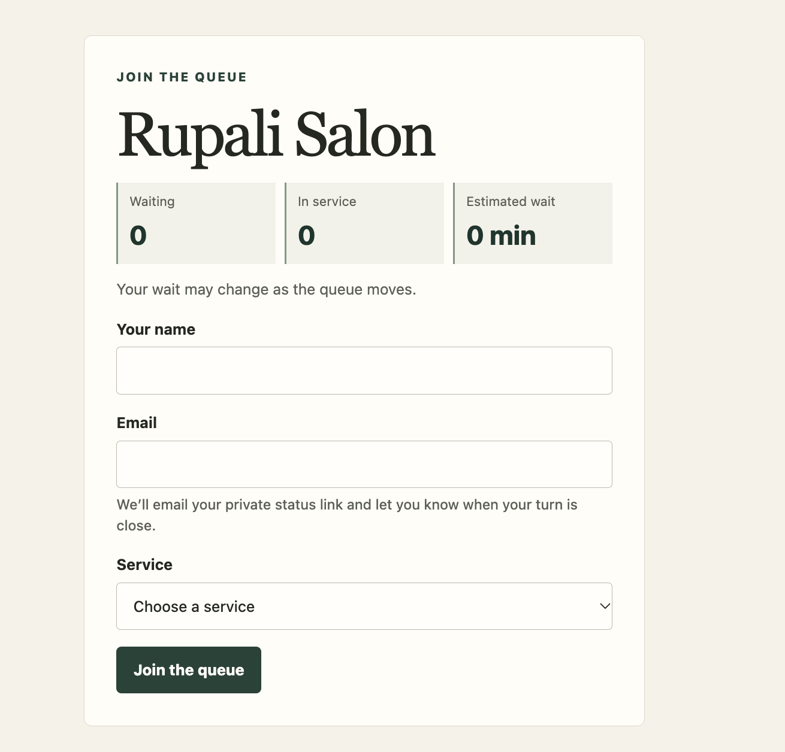
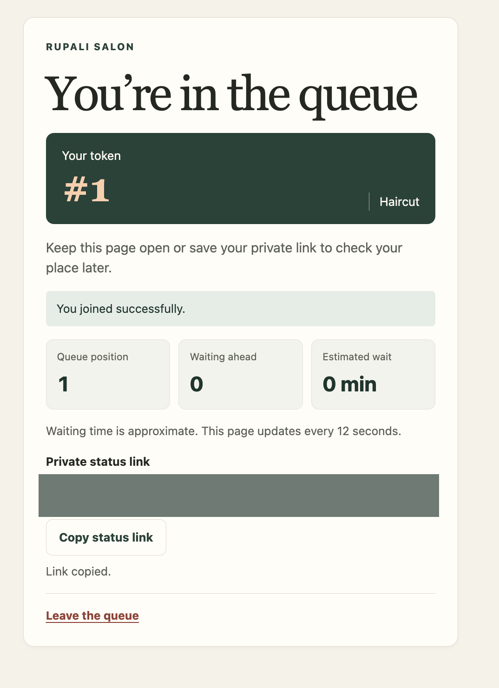
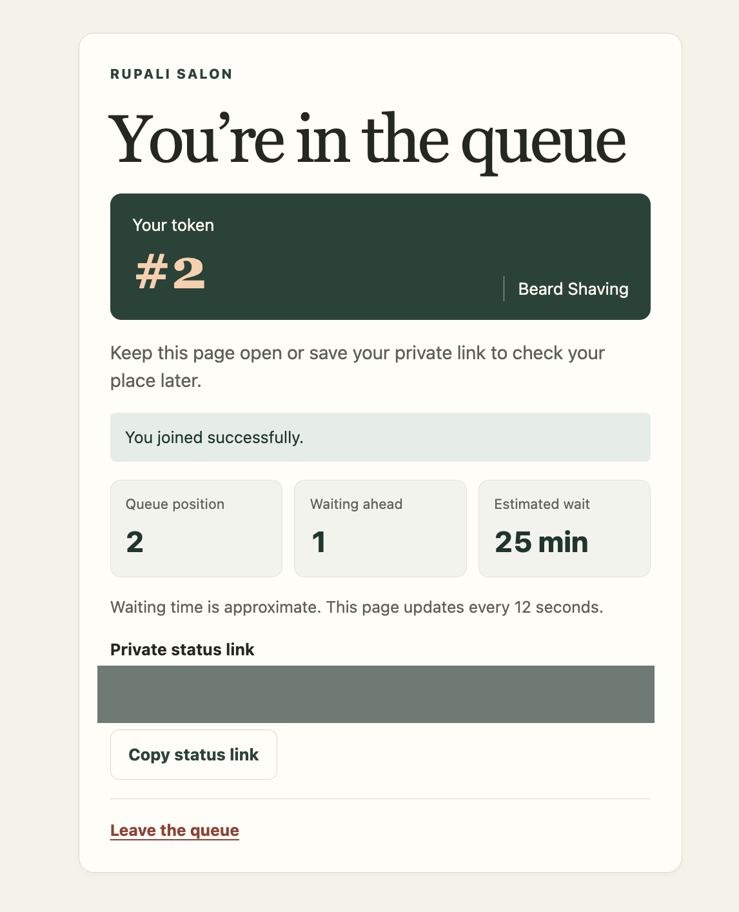
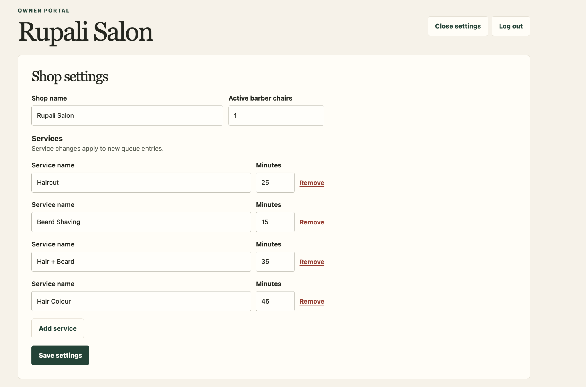
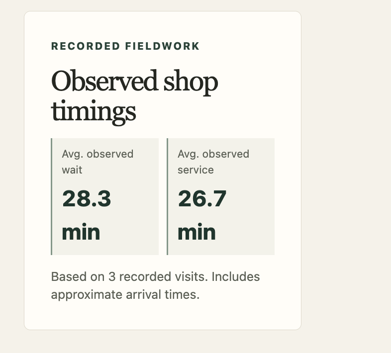
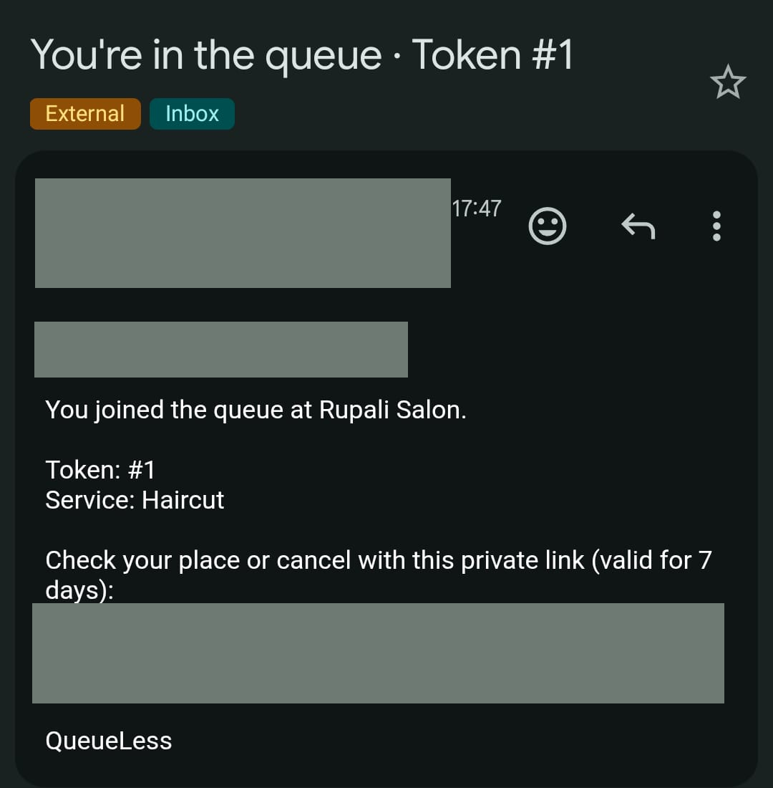
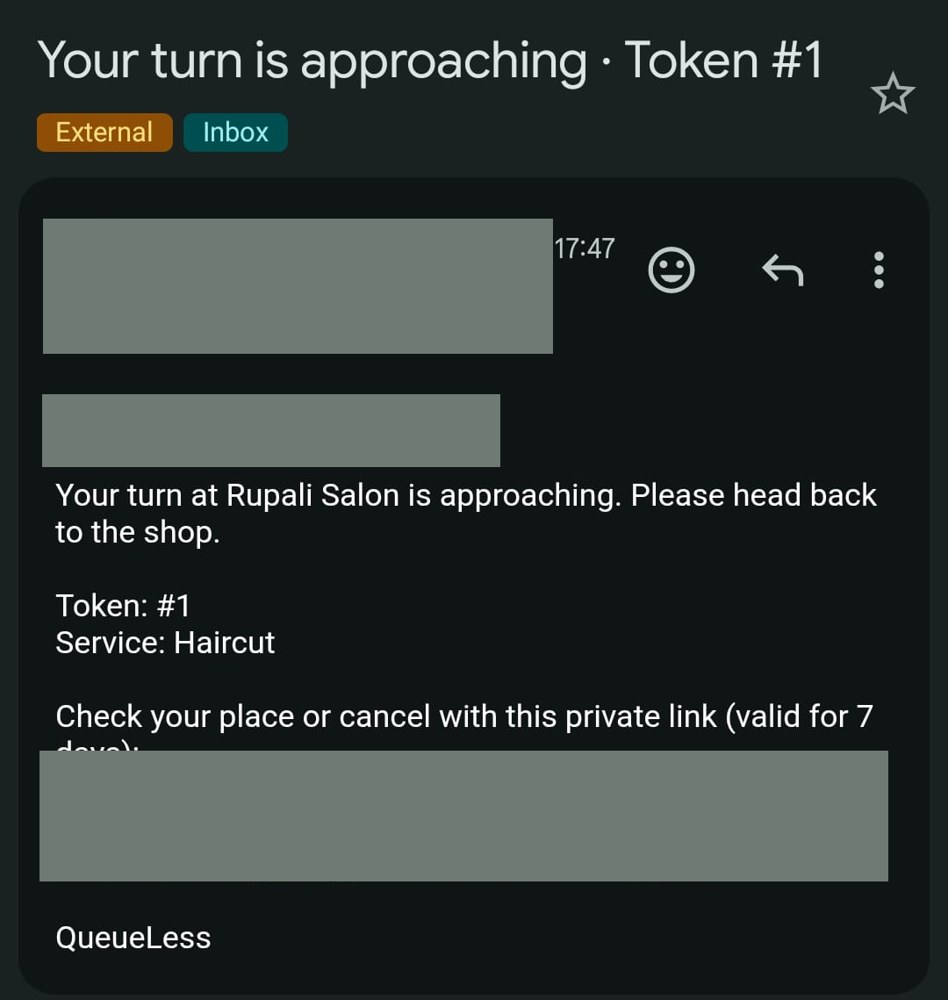

# ✂ QueueLess

**A QR-based walk-in queue for Rupali Salon in Masjid Chowk, Hajipur, Bihar.** Customers can step out while they wait and get an email when their turn is close. The barber manages the line from one dashboard.

[Run locally](#run-locally) · [Real output](#real-output) · [Architecture](#architecture) · [What it gets wrong](#what-it-gets-wrong) · [Demo and screenshots](#demo-and-screenshots)

<p align="center">
  
</p>

## The problem

Rupali Salon has limited waiting space. During busy periods, walk-in customers sometimes wait outside or leave when they cannot tell how long the wait will be. QueueLess was built to help **Ravish Kumar Thakur**, a barber at the salon. The field visit took place on **17 November 2026**, from **3:10 to 3:50 p.m.**

| Customer | Shop owner |
| --- | --- |
| Scan the shop QR code, pick a service, and join without an account. | Create a shop, configure chairs and services, and download a printable QR code. |
| Get a token and check the queue position and estimated wait from a private link. | Start the next service, then complete or cancel it. |
| Receive a confirmation and a turn-approaching email. | See live queue activity and recorded fieldwork timings. |

## Real output

The owner dashboard's **Observed shop timings** card reads [`data.csv`](./data.csv) and reports these results from the three usable visits currently recorded.

| Output | Value |
| --- | ---: |
| Usable visits | 3 |
| Average wait before service | 28.3 minutes |
| Average service duration | 26.7 minutes |

The observed waits were **5, 30, and approximately 50 minutes**. The corresponding services took **25, 30, and 25 minutes**. One arrival time is approximate. The current CSV contains **3 of the 20 real observations required by the brief**.

[Problem research and tools reviewed](./research.md) · [Conversation and collection notes](./fieldwork.md) · [Timestamped exterior photo](./photos/shop-exterior-2026-11-17-1528.png) · [Timestamped interior photo](./photos/shop-interior-2026-11-17-1531.png)

## What it gets wrong

- **A short visit can give a misleading average.** Three visits from one session cannot describe how long customers usually wait across a full week. An approximate arrival also affects the wait average.
- **Live waits can run low when a service overruns.** The estimate uses configured service durations, elapsed time, and active chairs. When a service exceeds its configured duration, its estimated remaining time drops to zero even if the customer is still in the chair.
- **The line depends on the barber updating it.** A missed completion keeps an entry in service and can delay the next alert. An SMTP failure can also prevent an alert from arriving while the customer status page remains available.

## Run locally

**Requirements** · Node.js 22.12+, npm, and a running MongoDB server.

Run from the repository root.

```bash
npm ci --prefix backend
npm ci --prefix frontend
test -f backend/.env || cp backend/.env.example backend/.env
openssl rand -hex 32
```

Copy the generated value into `JWT_SECRET` in `backend/.env`. The sample settings point to local MongoDB at `mongodb://127.0.0.1:27017/queueless`. Run one backend process when using standalone MongoDB.

<details>
<summary><strong>Gmail notifications</strong></summary>

Enable [Google 2-Step Verification](https://myaccount.google.com/signinoptions/two-step-verification) and create a [Google app password](https://myaccount.google.com/apppasswords). Enter these settings in `backend/.env`.

| Setting | Value |
| --- | --- |
| `SMTP_HOST` | `smtp.gmail.com` |
| `SMTP_PORT` | `465` |
| `SMTP_USER` and `EMAIL_FROM` | Your Gmail address |
| `SMTP_PASS` | Your Google app password |

Leave the SMTP credentials blank to run the queue locally without email.

</details>

Start the backend and frontend in separate terminals.

```bash
npm run dev --prefix backend
npm run dev --prefix frontend
```

Open [localhost:5173](http://localhost:5173), register an owner, create a shop, and click **Open join page**. For a phone demo, set `PUBLIC_APP_URL` to the frontend's reachable address, restart the backend, and download a fresh QR code.

<details>
<summary><strong>Production setup</strong></summary>

Use a MongoDB replica set or sharded cluster. Set `NODE_ENV=production` and set `PUBLIC_APP_URL` to the public HTTPS origin. Configure `TRUST_PROXY_HOPS` if Express is behind a trusted reverse proxy.

```bash
npm run build --prefix frontend
npm start --prefix backend
```

Express serves the built frontend and API from one origin. Include `frontend/dist` and `data.csv` in the deployment.

</details>

## Architecture



The browser refreshes queue data every 12 seconds. Express validates requests, issues shop-specific daily tokens, and manages queue transitions. Owner sessions use HTTP-only JWT cookies, and customer status links are signed and expire after seven days.

## Testing

```bash
npm test --prefix backend
npm run build --prefix frontend
TEST_MONGO_URI='mongodb://127.0.0.1:27017/' npm test --prefix backend
```

The integration suite uses a temporary MongoDB database and a local SMTP server that deliberately rejects messages. For the manual flow, join twice, start and complete the first service, and check that the second customer moves up. Verify the confirmation and turn alert in the recipient's inbox.

## AI chats

[Shared Codex and ChatGPT conversations](./ai-chats/README.md) used during the project.

## Demo and screenshots

[**Watch the QueueLess demo video**](https://drive.google.com/file/d/1HTITqEAgygA6oMlouB7ZUXm9S1B4c46k/view?usp=sharing)

| Join the queue | First in line | One customer ahead |
| --- | --- | --- |
|  |  |  |

| Shop settings | Recorded fieldwork |
| --- | --- |
|  |  |

| Queue confirmation | Turn-approaching alert |
| --- | --- |
|  |  |

Private status links, the demo QR code, and personal email details are redacted.
